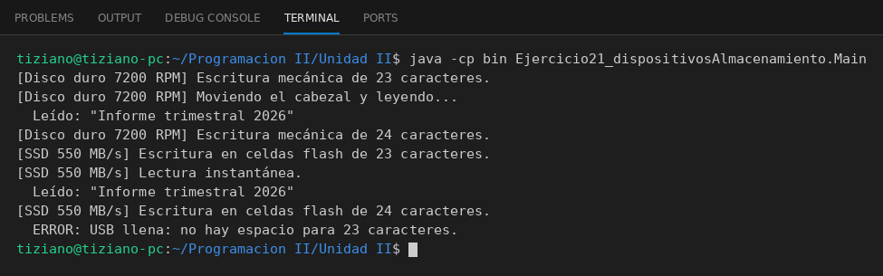

# DispositivoAlmacenamiento

Programación II - Unidad 2 - Ejercicio 21

## Consigna
Abstraer distintas unidades de almacenamiento con una interfaz común de lectura y escritura.

## Lógica
- Interfaz `DispositivoAlmacenamiento` con `escribirDatos(String)` y `leerDatos()`.
- `DiscoDuro`, `UnidadSSD` y `MemoriaUSB` la implementan con atributos propios (RPM, MB/s, si está conectada) y su propio comportamiento.
- Validación de desbordamiento: si los datos no caben se lanza `IllegalStateException`; la USB además exige estar conectada.
- `Main`: una `List<DispositivoAlmacenamiento>` recorrida polimórficamente, capturando los errores.

## Ejecución

